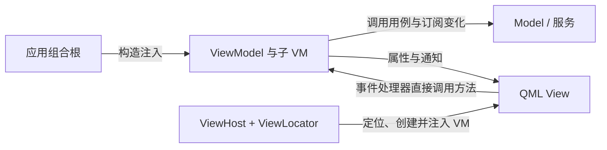

# Caliburn.Micro.Qt

受 **Caliburn.Micro** 启发，面向 **Qt Quick / QML 与 C++** 的 MVVM 支撑框架。

这是一个独立项目。名称表达对 [Caliburn.Micro](https://caliburnmicro.com/) 的架构借鉴，不代表官方移植、官方关联或完整 API 对等，也不引入 .NET 版 CM 库。

## 为什么创建这个项目

WPF 与 Caliburn.Micro 提供了一组相互配合的概念：属性通知、Screen 生命周期、Conductor 组合、视图定位、操作与守卫，以及窗口管理。开发者可以围绕 ViewModel 组织界面，而不用在每个页面重复处理这些连接。

Qt 已有属性绑定、信号、元对象系统和动态加载等基础机制，第三方也有 [QtMvvm](https://github.com/Skycoder42/QtMvvm) 等 MVVM 项目。项目动机并不是“Qt 完全没有 MVVM 框架”，而是希望为 Qt Quick 建立一套以 CM 风格为核心、边界明确、可验证的组合约定。

我们希望减少这些重复工作：父 View 转发子组件的一组属性和信号，页面与业务对象的生命周期连接，页面切换混入业务状态判断，以及创建对象时底层依赖沿父子 VM 构造链传播。

这里的“严格遵循 MVVM”指本项目的设计约定。目前没有自动强制检查架构的能力；是否遵守这些边界，仍需要应用设计、代码评审和后续测试共同保证。

Bootstrapper 自动创建窗口服务，由 WindowManager 创建根窗口，并以独立应用级模态窗口承载弹窗 View。内置确认视图无需应用登记。根工厂接收 `std::shared_ptr<IWindowManager>`，由应用组合根注入所需业务 VM；Shell View 只描述业务界面。用法见 [Bootstrapper](docs/Bootstrapper.md) 和 [WindowManager](docs/WindowManager.md)。

## 视图约定定位

```cpp
#include <CaliburnMicroQt/ViewLocator.h>
// configure 中一次配置；Bootstrapper 成功配置后自动冻结。
return ViewLocator::addSearchRoot({
    QUrl(QStringLiteral("qrc:/qt/qml/CaliburnExample/"))});
```

ViewLocator 统一根窗口、页面和弹窗定位。示例 Shell、Home、Detail 按约定定位，无需逐项登记；特殊视图可用 `ViewLocator::registerView<T>(url)` 显式覆盖。定位顺序为显式映射、约定搜索；支持 ViewModel → View、同命名空间及 ViewModels → Views 目录布局。框架资源目录自动作为最后一个搜索根，应用也可通过搜索根下的 `views/ConfirmActionView.qml` 覆盖内置确认视图。

ViewLocator 和 ViewHost 接受普通 QObject，具体模型类型须声明自己的 Q_OBJECT，View 声明 `required property XxxViewModel viewModel`，属性变化由模型自己的 NOTIFY 驱动。窗口、Bootstrapper 根工厂和 Conductor 同样允许 QObject，按可选接口参与生命周期与关闭守卫；泛型 Conductor 仍校验所配置的成员类型。ViewLocator 是公开定位入口，ViewRegistry 仅作为内部实现。完整规则见 [ViewLocator](docs/ViewLocator.md)。Page 后缀、context 多视图与自定义转换规则尚未实现，见 [后续待办](docs/计划/后续版本ToDoList.md)。

## 架构原则

- **View 绑定单个、明确类型的 VM**：业务 View 声明 `required property XxxViewModel viewModel`，通过属性读取、通知和操作表达交互。纯样式、按钮和 delegate 不必拥有独立业务 VM。
- **Model 与服务保存业务事实和规则**：VM 组织展示、操作意图及交互流程，页面激活状态不能代替业务会话状态。
- **VM 不持有控件**：VM 不保存 QML Item、按钮或窗口引用；焦点、键盘事件和布局留在 View 与通用视觉组件中。
- **父 VM 组合子 VM**：父对象接收所需子对象及自己直接使用的服务，不替子对象转交全部底层依赖。View 通过子 VM 属性嵌套装配。
- **组合根负责创建**：应用集中装配服务和 VM 树；需要按需创建时由应用提供类型化工厂，业务 VM 不访问容器或服务定位器。
- **所有权与生命周期分别明确**：C++ 持有 VM 树，QML 持有 View 树；View 先于其借用的 VM 销毁。装载或卸载 View 不隐式开始业务，也不隐式删除 VM。
- **所有权标记由对应入口保证**：Bootstrapper 为其创建的窗口服务和根 VM 设置 CppOwnership，WindowManager 为窗口及弹窗模型设置，Conductor 保护待接管候选并在接管时设置；组合层不重复设置。其他对象按创建和暴露方式处理，详见 [所有权约定](docs/ViewModelBase.md#6-所有权线程与生命周期)。CppOwnership 阻止引擎删除对象，实际释放仍由 RAII、成员存储或 QObject 父子关系负责。
- **操作显式绑定**：View 手写 enabled 与事件处理器，直接读取 VM 的可用状态并调用方法。VM 和业务用例各自检查职责内的前置条件，按钮禁用只是展示结果。

数据与操作路径：



## 与 Caliburn.Micro 的概念对应

这是职责上的借鉴，不能理解成接口一一移植。

| Caliburn.Micro 概念 | Qt 类型或方案 | 1.0 行为 |
| --- | --- | --- |
| PropertyChangedBase | ViewModelBase + QObject 属性系统 | 派生 VM 声明 Q_PROPERTY / NOTIFY，基类提供类型化 setAndNotify；不提供字符串通知入口。 |
| IChild / IParent / IConductor | 纯 C++ 协议与 ConductorBase | Screen 提供只读逻辑 Parent；统一子项快照和已接管对象的激活、停用接口。 |
| Screen | ScreenViewModel | 框架自动驱动，先提交状态再执行钩子；初始化一次，激活与普通停用幂等，已初始化对象每次关闭都执行钩子；异常不回滚已提交状态。 |
| `Conductor<T>` | 单项 Conductor 与 Collection.OneActive | 单项切换关闭旧当前项；集合切换保留旧成员，仅当前项激活。对象回收由所有者安排。 |
| ViewLocator / ViewModelBinder | ViewLocator、ViewHost | 显式映射优先，按搜索根及命名空间约定定位，创建前注入 typed viewModel。 |
| ActionMessage / CanXxx | QML 原生属性绑定与事件处理器 | 1.0 不移植动作组件；显式绑定 enabled 并调用具体 VM，方法自身检查业务条件。 |
| IWindowManager / WindowManager | IWindowManager、WindowManager、内部 DialogWindow | 创建普通 QQuickWindow 窗口与独立模态弹窗，统一关闭守卫和双向关闭桥接；弹窗以 QFuture 交付结果。 |
| IGuardClose / 关闭策略 | Conductor 关闭守卫与直接许可回调 | 覆盖成员关闭、单项替换及普通停用、父级关闭许可，以及窗口关闭；许可可延后交付，生命周期同步执行。 |
| IoC / 构造注入 | 应用组合根 + Boost.Ext.DI v1.3.2 | 创建与长期持有分开，框架 VM 不依赖容器。 |
| Bootstrapper | BootstrapperBase + AppBootstrapper | configure 配置定位规则与根工厂，onStartup 显示根窗口，run 统一生命周期与清理。 |

## 核心类型与契约

以下类型构成 1.0 的公开能力；DialogWindow 为模块内部实现。所有权与逻辑 Parent 分别管理，业务模型可继承 ScreenViewModel，也可使用普通 QObject 并实现所需接口。

| 类型 | 形态 | 职责 |
| --- | --- | --- |
| ViewModelBase | C++ QObject 基类 | 提供共同类型及 protected setAndNotify，不新增业务属性、状态或信号；完整成员见专题。 |
| ScreenViewModel | C++ VM 基类 | 实现 IActivate、IDeactivate、IChild、IGuardClose，提供同步生命周期、只读逻辑 parentViewModel 与 tryClose。 |
| IChild / IParent / IConductor | 纯 C++ 接口 | 逻辑父级、借用子项快照与统一管理接口。 |
| IActivate / IDeactivate | 纯 C++ 能力接口 | 激活、停用及带 QObject 上下文的尝试/完成通知订阅。 |
| ConductorBase | 抽象元对象基类 | 抽象管理接口、延迟关闭策略、ensureItem 和 activationProcessed。 |
| ConductorBaseWithActiveItem | 公共活动项基类 | 可读写 activeItem、统一切换顺序和销毁通知。 |
| ConductorSingleItem / `Conductor<T>` | C++ Screen 子类与模板层 | 一个当前项；子项普通停用清空选择并留存 VM，切换关闭旧当前项。 |
| ConductorCollectionOneActiveBase / `ConductorCollectionOneActive<T>` | C++ Screen 子类与模板层 | 保留多个 VM，仅当前项激活；关闭当前项按前一项优先选择剩余成员。 |
| ViewLocator | C++ 配置入口与 QML 查询单例 | 统一登记、配置、冻结和 QObject 视图定位，不拥有模型。 |
| ViewHost | QML 组件 | 使用 Loader 定位和加载 View，并注入唯一 viewModel 属性。 |
| ViewHostState | 公开、可创建的 QML 辅助类型 | 保护 VM 借用并验证 View 注入；页面装配优先使用 ViewHost，见 [公开接口](docs/ViewHost.md#4-借用与所有权)。 |
| BootstrapperBase | C++ 应用启动基类 | 编排配置、根对象创建、窗口加载、生命周期及退出清理，不依赖 DI 库。 |
| IWindowManager | 抽象 QObject 服务 | showWindow 借用普通窗口模型；showDialogAsync 接管弹窗模型，以 `QFuture<DialogResult>` 交付结果。 |
| WindowManager | C++ 服务 | 创建窗口与弹窗，管理类型化注入、可选生命周期、守卫、资源清理及焦点恢复。 |
| DialogWindow | 模块私有 C++ 窗口 | 承载 Item View，设置应用级模态；服务负责守卫、清理与焦点恢复。 |
| ConfirmActionViewModel | C++ Screen 子类 | 提供确认文案、accept / cancel 操作与一次完成结果。 |
| ConfirmActionView | QML View | 展示确认 VM，通过手写事件处理器调用接受或取消方法。 |
| IGuardClose / ICloseStrategy / DefaultCloseStrategy | C++ 回调协议与默认策略 | canClose(callback) 立即或延后交付许可；适用场景包括关闭及单项成员普通停用，拒绝时保留成员、选择和页面。 |

**ConfirmationRequest** 保存 `title`、`message`、`confirmText`、`cancelText`，不保存业务操作枚举、控件或 VM 引用；它是确认 VM 的文案参数，不限制 IWindowManager 只能展示确认框。

ViewModelBase 自身仅提供构造函数、默认虚析构和 protected 模板辅助 `setAndNotify(field, value, &Owner::notifySignal)`。同值不通知，更新先赋值再同步通知；空信号或对象类型不兼容时诊断并拒绝修改。它没有 displayName、字符串通知入口或生命周期状态；QObject 的继承成员继续可用。完整接口、QML 注册与所有权约定见 [ViewModelBase](docs/ViewModelBase.md)。

窗口服务、根工厂和 Conductor 均允许普通 QObject，按 IActivate、IDeactivate、IGuardClose、IChild 选择性参与生命周期。Conductor 默认模板类型为 QObject；IDeactivate 提供带 QObject 上下文的尝试/完成通知订阅。Screen.tryClose 优先委托逻辑 Parent Conductor，否则直接关闭弱关联窗口；窗口先创建绑定，再激活模型并显示。普通窗口借用模型，弹窗消费 unique_ptr；完整接口和消费工程适配说明见 [接口化迁移](docs/接口化迁移.md) 与 [tryClose 窗口直接关闭](docs/tryClose窗口直接关闭.md)。

[Screen](docs/ScreenViewModel.md) 初始化一次、同步执行生命周期，提供只读逻辑 Parent。Screen 实现 IActivate、IDeactivate，两个 Conductor 通过共享 ScreenExtensions 按接口驱动子项生命周期；普通 VM 可独立实现其中一个或两个接口。普通 ViewModelBase 默认不实现 IChild；自行声明该接口的 VM 也能接入。QObject 父树负责所有权，逻辑 Parent 由 Conductor 独立维护。

单项 `deactivateItem(item, false)` 清空选择并普通停用，保留 VM、Parent 和恢复资格；`activateItem(item)` 恢复原对象。切换新项关闭旧当前项，旧对象仍由 QObject 父树持有；`closeItem` 只处理当前项。已初始化单项父关闭只处理当前项并保留选择，集合父关闭清空成员但保留 ActiveItem；未初始化父关闭无操作；父普通停用仍保留选择。`getChildren()` 在单项只返回当前项，集合型返回全部成员，均为借用快照。详见 [Conductor](docs/Conductor.md)。

新项以类型化 unique_ptr 接管，校验 QObject 父对象、线程、自身或祖先、IActivate 活动状态及逻辑 Parent。基础校验拒绝不移动调用方所有权；通过后单项请求暂存候选，许可拒绝或回调释放时回收，通过时接管并设置父对象；对象使用 CppOwnership。单项裸指针入口可重新选择本 Conductor 接管过的有效旧对象；关闭生命周期不自动删除对象；裸指针入口只接受本 Conductor 已接管的有效对象。调用方保证主线程同步、转换不重入；受管 Screen 的 C++ tryClose 通过逻辑 Parent 委托 IConductor 关闭，根窗口请求通过双向关闭桥接处理。

showWindow 接受保留具体模型指针类型的 QVariant，View 须以 QQuickWindow 为根；单服务管理一个主窗和多个独立辅助窗。showDialogAsync 接受自定义 QObject 模型，由 C++ 创建独立应用级模态窗口承载 Item View，并通过 QFuture / QPromise 交付一次结果；第三个可选参数 DialogOptions 仅设置原生 title，默认空字符串，与正文标题独立。弹窗统一属于主窗，单服务只允许一个当前弹窗，忙时拒绝新请求，请求者销毁时强制清理。DialogResult 为 `std::optional<bool>`：true 表示接受，false 表示明确取消，空值表示无决定关闭；忙和展示失败以异常交付。不使用嵌套事件循环，完整规则见 [WindowManager](docs/WindowManager.md)。

activateItem、deactivateItem、closeItem、tryClose 是 void 请求，无完成回调。激活看 activationProcessed，实际停用/关闭看 deactivated(close)，方法返回不保证完成。默认策略检查 getChildren 快照后汇总，单项只有当前项，集合包含全部成员；拒绝时不部分关闭。关闭许可采用 CM 风格的直接回调，不支持重叠请求、重复回调或等待期间修改参与对象。主窗口关闭与根 tryClose 接入同一守卫链，退出时根关闭收尾和 onExit 各执行一次；onStartup 与 onExit 均为 void 钩子，正常退出钩子在 aboutToQuit 执行。完整契约见 [关闭守卫](docs/关闭守卫.md) 和 [Bootstrapper](docs/Bootstrapper.md)。

## 模块与项目结构

框架与示例用户代码分别组织为静态 QML 模块；示例装配、日志出口与启动程序各自独立。独立消费工程通过公开接口接入框架。

| 单元 | CMake 目标 | QML URI / 版本 | 职责 |
| --- | --- | --- | --- |
| 通用框架模块 | `CaliburnMicroQt`，别名 `Caliburn::MicroQt` | `Caliburn.Micro.Qt 1.0` | 属性通知、生命周期接口、单项与集合型 Conductor、ViewLocator、ViewHost、窗口服务及确认框。 |
| 示例用户代码模块 | `CaliburnExampleModule` | `CaliburnExample 1.0` | Shell 根窗口、Home 计数页、Detail 只读详情、共享计数服务、参数按钮、键盘输入、重置及退出确认。 |
| 示例装配库 | `CaliburnExampleComposition` | 无独立 QML URI | Boost.Ext.DI 绑定共享服务及 Home/Detail 工厂，创建并返回根 Shell；所有权标记由框架入口保证，子项由 Conductor 接管。 |
| 示例启动程序 | `CaliburnExampleApp` | 无独立 QML URI | AppBootstrapper 配置定位规则与根工厂，Bootstrapper 编排启动退出，WindowManager 负责窗口创建、类型化注入和关闭生命周期。 |
| 示例日志库 | `CaliburnExampleLogging` | 无独立 QML URI | 将 Qt/QML 分类日志统一输出到 spdlog 控制台与轮转文件。 |
| 独立消费工程 | `CaliburnConsumerModule`、`CaliburnConsumerApp` | `CaliburnConsumer 1.0` | 独立 CMake 项目，只通过公开接口使用框架，附带集成测试。 |

框架和用户模块均采用静态库，通过 `qt_add_qml_module` 组织各自的 C++ 与 QML；应用的两个插件由 Qt 导入扫描链接，QML 测试仅显式补充动态 URL 加载所需的示例插件，并保留 Q_IMPORT_QML_PLUGIN 导入。静态类型注册与内嵌资源支持运行期按 URL 加载，链接关系避免重复导入同一插件。示例装配库采用 Boost.Ext.DI，Shell 通过构造注入工厂，由 Conductor 接管 Home；两个 QML 模块和 VM 头文件不包含 DI。

```text
caliburn-micro-qt/
├── .github/workflows/ci.yml       # 构建、测试与独立消费验证
├── docs/                          # 接口文档、历史记录与后续计划
├── modules/Caliburn/Micro/Qt/      # 通用框架静态 QML 模块
├── examples/
│   ├── minimal/                  # Shell、Home、Detail 完整示例
│   │   ├── app/                  # 启动、组合根与日志出口
│   │   └── CaliburnExample/       # 示例用户代码模块
│   └── standalone/               # 独立消费工程及集成测试
├── cmake/                         # FetchContent 依赖接入
├── third_party/boost-di/          # 依赖来源说明与许可证
├── tests/                         # 核心、装配、日志与 QML 集成测试
├── CMakeLists.txt                 # 模块与构建选项
└── CMakePresets.json              # 可移植 debug 预设
```

依赖方向为“启动程序 → 应用装配库 → 用户代码模块 → 框架模块 → Qt”；装配库私有依赖 Boost.Ext.DI，日志库私有依赖 spdlog。AppBootstrapper 配置应用搜索根与 Shell 工厂，WindowManager 通过 ViewLocator 定位 ShellView 并注入 typed viewModel，子页面由 ViewHost 装配。框架默认搜索根提供内置确认视图，框架不引用用户类型或业务模块。

Shell 是本项目的应用入口命名约定，与 qt-snake-lab 的入口命名保持一致。ShellViewModel 继承 `Conductor<ScreenViewModel>::Collection::OneActive`，ShellView.qml 是根窗口；Home 与 Detail 共享 CounterService。集合保留 Home VM，ViewHost 在页面切换时卸载旧 View、返回时重新创建。

完整目录、类型归属、模块接入及 qt-snake-lab 调整概要见 [模块与项目结构](docs/模块与项目结构.md)。该概要只规划游戏仓库的后续接入，尚未修改其结构设计。

## 多屏示例

新增 [examples/multiscreen](examples/multiscreen/README.md)，构建目标为 `CaliburnMultiScreenApp`。默认在满足条件的麒麟 X11 四屏环境跨屏显示，否则打开两个普通预览窗口；支持 `--strict-screens` 和 `--auto-close 5`。

主窗保留退出按钮，无 Esc 退出逻辑。关闭辅助窗不影响主窗；主窗成功关闭后收尾辅助窗并退出。窗口配置通过 WindowOptions 传入，Bootstrapper 保留一个根 VM，辅助窗由同一窗口服务管理。接口见 [WindowManager](docs/WindowManager.md)，验证见 [多窗口与多屏示例验收记录](docs/验收/多窗口与多屏示例验收记录.md)。

## 技术要求与边界

| 项目 | 要求与支持范围 |
| --- | --- |
| Qt | 6.8.3 及以上，Qt Quick / QML；macOS arm64 与麒麟 x86_64 的构建和自动检查已通过，Qt Creator 人工 GUI 验收尚待确认。 |
| C++ | C++17，QObject 属性、信号与元对象系统。 |
| 构建 | CMake 3.21 及以上、Ninja、qt_add_qml_module；框架/示例用户模块为静态库。 |
| 应用装配 | Boost.Ext.DI v1.3.2 由 FetchContent 获取，下载官方单头文件并校验 SHA-256；许可证随仓库保留。 |
| 操作与输入 | QML 显式读取可用状态并直接调用方法；示例演示无参数、int 参数和原生键盘事件。框架不规定方法名、返回值或自动动作守卫契约。 |
| 视图映射 | ViewLocator 提供显式映射与约定搜索，配置在初始化阶段冻结；不依赖某个示例的页面数量。 |

Home 和 Detail 显式接收非空 `shared_ptr<CounterService>`，唯一计数由服务保存。Shell 接收 Home、Detail 页面工厂，两个页面分别接收共享计数服务与 IWindowManager；Home.reset 通过确认后才重置，停用时使旧请求结果失效，并通过确认框 tryClose(std::nullopt) 请求关闭；请求者销毁时由窗口服务自动强制清理。进入 Detail 保留并停用 Home VM；Detail 内的返回按钮调用 goBack → tryClose，通过 Parent 委托 Shell 关闭自己，自动选回 Home。home/detail 从集合查找，ViewHost 绑定 activeItem。Home View 离开即卸载、返回重新创建，计数和 VM 保留，文本及焦点按新页面初始化。Shell 关闭清空全部成员并保留旧 ActiveItem，再激活时识别非成员选择并新建 Home；旧 VM 由所有者回收。DI 仅在装配层，每个 buildShell 的服务独立。详见 [应用装配](docs/IoC与应用装配.md)、[Conductor](docs/Conductor.md) 与 [关闭守卫](docs/关闭守卫.md)。

## 阅读文档

- [模块与项目结构：框架、用户代码与贪吃蛇接入概要](docs/模块与项目结构.md)
- [下游接入：源码模块、静态插件与独立消费工程](docs/下游接入.md)
- [IoC 与应用装配：构造注入、父所有权与根生命周期](docs/IoC与应用装配.md)
- [Bootstrapper：配置、根窗口启动与退出清理](docs/Bootstrapper.md)
- [ViewModelBase：类型基础、完整成员与通知辅助](docs/ViewModelBase.md)
- [ScreenViewModel：同步生命周期](docs/ScreenViewModel.md)
- [Conductor：单项与 Collection.OneActive](docs/Conductor.md)
- [关闭守卫：许可回调与成员关闭策略](docs/关闭守卫.md)
- [ViewLocator：约定定位、显式覆盖与配置冻结](docs/ViewLocator.md)
- [ViewHost：视图定位、动态加载与所有权](docs/ViewHost.md)
- [WindowManager：普通窗口、通用模态弹窗与重置确认](docs/WindowManager.md)
- [QObject 能力接口与消费工程适配](docs/接口化迁移.md)
- [tryClose：逻辑 Parent 委托与窗口直接关闭](docs/tryClose窗口直接关闭.md)
- [操作与输入绑定：显式条件、方法调用与键盘事件](docs/操作与输入绑定.md)
- [日志接入：Qt 分类、调用位置与 spdlog 输出](docs/日志接入.md)
- [后续版本 ToDoList：视图定位扩展、View 保留与 Action](docs/计划/后续版本ToDoList.md)

设计起点来自 [qt-snake-lab](https://github.com/soapgu/qt-snake-lab) 中的 [Qt 实现方案](https://github.com/soapgu/qt-snake-lab/blob/main/docs/贪吃蛇Qt实现方案.md) 与 [源码结构设计](https://github.com/soapgu/qt-snake-lab/blob/main/docs/贪吃蛇Qt源码结构设计.md)。贪吃蛇用于解释页面、子 VM 与动态释放，是框架的使用场景，不是框架的业务边界。

## 构建、运行与测试

example 与测试通过 CMake FetchContent 自动获取 spdlog v1.17.0 和 Boost.Ext.DI v1.3.2，固定版本并校验 SHA-256，无需系统安装或设置 `spdlog_DIR`。首次配置需访问官方 GitHub 归档及单头文件，源码及构建产物默认保存在构建目录的 `_deps` 中；仅框架构建不获取这两个依赖。离线使用方法见 [日志接入](docs/日志接入.md#依赖下载与离线构建)。

example 使用 `caliburn.example` 分类，框架按职责使用 `caliburn.microqt.*` 分类；项目维护的日志正文及异常诊断统一使用英文，界面保持中文。Debug 构建默认输出 Debug 及以上，其余构建默认输出 Info 及以上；包含类/函数与文件行号。控制台和轮转文件同步输出，启动时打印文件位置；Qt/QML 诊断也进入同一出口。过滤和格式仍使用 `QT_LOGGING_RULES`、`QT_MESSAGE_PATTERN`，详见 [日志接入](docs/日志接入.md)。

需要 Qt 6.8.3 及以上（框架需要 Core/Qml/Quick/QuickControls2，测试另需 Test）、CMake 3.21 及以上、Ninja 和支持 C++17 的编译器。将 QT_ROOT 设置为本机 Qt kit 的根目录；公共预设不包含个人路径。

```sh
export QT_ROOT="你的 Qt kit 根目录"
cmake --preset debug
cmake --build --preset debug
ctest --preset debug
cmake --build --preset debug --target all_qmllint
```

macOS 启动 `build/debug/bin/CaliburnExampleApp.app`，也可执行：

```sh
./build/debug/bin/CaliburnExampleApp.app/Contents/MacOS/CaliburnExampleApp
```

Linux 入口为 `build/debug/bin/CaliburnExampleApp`；已在麒麟完成原生构建与离屏测试，Qt Creator 人工 GUI 验收尚待确认。CTest 的 QML 测试默认使用 offscreen/software；macOS 可额外运行 `QT_QPA_PLATFORM=cocoa ./build/debug/tests/CaliburnQmlTests`。离屏测试通过不代表已完成人工窗口交互验证。

示例支持“加 2”按钮与无修饰数字键 `2`，计数超过 3 时禁用。文本框中的数字键用于输入文字，点击空白处恢复页面焦点；长按重复事件不会增加计数。

普通按钮直接绑定 VM 的可用状态与方法，objectName 仅用于对象标识与测试：

```qml
Item {
    id: root
    required property HomeViewModel viewModel

    Button {
        objectName: "increment"
        text: root.viewModel ? root.viewModel.incrementText : "增加"
        enabled: root.viewModel !== null && root.viewModel.canIncrement
        onClicked: { if (root.viewModel) root.viewModel.increment() }
    }
    Button {
        objectName: "reset"
        text: "重置"
        enabled: root.viewModel !== null && root.viewModel.canReset
        onClicked: { if (root.viewModel) root.viewModel.reset() }
    }
}
```

片段省略 QtQuick、QtQuick.Controls 与用户模块导入。特殊目标在表达式中直接引用具体 VM；可空目标显式处理空值。属性的 NOTIFY 驱动 enabled 刷新，VM 方法自身检查条件。框架不扫描按钮、不管理 enabled、不按名称寻找方法；完整用法见 [操作与输入绑定](docs/操作与输入绑定.md)。

仅构建框架时关闭示例和测试：

```sh
cmake -S . -B build/framework-only -G Ninja -DCMAKE_PREFIX_PATH="$QT_ROOT" \
    -DCALIBURN_BUILD_EXAMPLE=OFF -DCALIBURN_BUILD_TESTS=OFF
cmake --build build/framework-only
```

框架以源码静态 QML 模块接入，公开 CMake 目标为 `Caliburn::MicroQt`，QML 导入为 `Caliburn.Micro.Qt 1.0`；尚未提供安装导出包或 `find_package(CaliburnMicroQt)` 支持。[独立消费工程](examples/standalone) 具有自己的 VM、QML 模块、Bootstrapper 和集成测试，仅依赖框架，不引入示例模块、Boost.Ext.DI 或 spdlog。公开头文件、静态插件保留、资源别名和 Qt Creator 运行方式见 [下游接入](docs/下游接入.md)。

## 推荐接入：FetchContent 跟随 main

建议业务项目通过 CMake FetchContent 获取框架源码，跟随 `main` 分支更新。在业务项目完成 Qt 初始化后、定义业务 QML 模块前加入：

```cmake
include(FetchContent)

# 仅引入框架，不构建框架仓库的示例和测试。
set(CALIBURN_BUILD_EXAMPLE OFF CACHE BOOL "" FORCE)
set(CALIBURN_BUILD_TESTS OFF CACHE BOOL "" FORCE)

FetchContent_Declare(
    CaliburnMicroQt
    GIT_REPOSITORY https://github.com/soapgu/caliburn-micro-qt.git
    GIT_TAG main
)
FetchContent_MakeAvailable(CaliburnMicroQt)
```

业务 QML 模块通过 `DEPENDENCIES TARGET CaliburnMicroQt` 声明导入依赖，并链接公开 C++ 目标。以下 `MyApplicationModule` 为业务模块示例名称，源码和 QML 文件按自己的项目填写：

```cmake
qt_add_qml_module(MyApplicationModule
    STATIC
    URI MyApplication
    VERSION 1.0
    RESOURCE_PREFIX /qt/qml
    DEPENDENCIES TARGET CaliburnMicroQt
    SOURCES HomeViewModel.h HomeViewModel.cpp
    QML_FILES views/HomeView.qml
)
target_link_libraries(MyApplicationModule PUBLIC Caliburn::MicroQt)
```

C++ 使用 `#include <CaliburnMicroQt/ScreenViewModel.h>` 等公开头文件；QML 使用 `import Caliburn.Micro.Qt 1.0`。ViewLocator 按 URL 动态加载视图时，还须确保应用与框架的静态 QML 插件被链接并注册；完整配置参考 [独立消费工程](examples/standalone/CMakeLists.txt) 与 [入口插件导入](examples/standalone/main.cpp)。仅接入框架不会下载示例使用的 Boost.Ext.DI 或 spdlog。

首次配置时下载源码，后续重新运行 CMake 配置时尝试同步远程 `main`，再重新构建应用。Qt Creator 中执行“运行 CMake”后构建；命令行可在业务项目根目录执行：

```sh
cmake -S . -B build -G Ninja -DCMAKE_PREFIX_PATH="$QT_ROOT"
cmake --build build
```

`QT_ROOT` 指向本机 Qt kit。普通编译不一定重新运行 CMake，因此不会持续自动同步。同步需要网络可用，且未开启 `FETCHCONTENT_UPDATES_DISCONNECTED`、`FETCHCONTENT_UPDATES_DISCONNECTED_CALIBURNMICROQT` 或 `FETCHCONTENT_FULLY_DISCONNECTED`；也不要通过 `FETCHCONTENT_SOURCE_DIR_CALIBURNMICROQT` 覆盖为由自己维护的本地源码。更新行为见 [CMake FetchContent 文档](https://cmake.org/cmake/help/latest/module/FetchContent.html)。跟随 `main` 会同时接收框架接口变化，业务项目需相应调整；需要复现某次构建时，可将 `GIT_TAG` 改为具体标签或提交。

## 持续集成

[GitHub Actions CI](https://github.com/soapgu/caliburn-micro-qt/actions/workflows/ci.yml) 在推送 main、向 main 提交 PR 或手动触发时运行。工作流固定 Qt 6.8.3，分别使用 Ubuntu 24.04 x64 与 macOS 15 arm64，覆盖框架和示例构建、全部 CTest、all_qmllint、仅框架构建、Release 日志默认级别与调用位置，以及仓库外独立消费工程的构建与集成测试。

QML 测试使用 offscreen/software；CI 不替代 Cocoa 人工窗口操作或麒麟验收。Qt 安装缓存用于减少重复下载，测试报告及配置日志保存 7 天，可在每次运行的附件中下载。工作流文件位于 [.github/workflows/ci.yml](.github/workflows/ci.yml)。

## 1.0 版本发布

1.0 提供从属性通知、页面组合到窗口管理的 Qt Quick MVVM 支撑能力，并配套完整示例、独立消费工程与自动检查。

| 功能 | 1.0 提供的能力 |
| --- | --- |
| 属性与生命周期 | ViewModelBase 类型化通知辅助；Screen 初始化、激活与停用；普通 QObject 按 IActivate、IDeactivate、IChild、IGuardClose 选择性参与。 |
| 页面组合与关闭 | 单项及 Collection.OneActive Conductor、逻辑 Parent、活动项切换、成员管理、关闭许可与 tryClose 委托。 |
| 视图定位与装配 | ViewLocator 搜索根、命名及命名空间约定、显式覆盖、配置冻结；ViewHost 动态加载并注入类型化 viewModel。 |
| 应用与窗口 | Bootstrapper 启动退出编排、普通窗口、独立应用级模态弹窗、异步结果、关闭守卫与双向关闭桥接、内置确认框。 |
| 日志与示例 | 框架分类日志；示例 spdlog 控制台与轮转文件出口；Shell/Home/Detail 展示共享计数、参数与键盘输入、导航、重置及退出确认。 |
| 接入与验证 | 静态 QML 源码模块、公开 C++ 头文件与 CMake 目标、仓库外独立消费工程；Ubuntu/macOS CI 配置及麒麟原生构建与自动检查。 |

1.0 的 ViewHost 每次切换都会重新创建 View，集合导航只保留 VM。Action 动作绑定、View 实例缓存、Page 后缀、context 多视图及自定义定位转换规则留待后续版本，见 [后续版本 ToDoList](docs/计划/后续版本ToDoList.md)。安装导出包和独立应用分发包尚未提供；平台自动检查与人工 GUI 验收分别确认。

## 参考与许可

- [Caliburn.Micro：组合与生命周期](https://caliburnmicro.com/documentation/composition)
- [Caliburn.Micro：操作与守卫](https://caliburnmicro.com/documentation/actions)
- [Caliburn.Micro：命名约定](https://caliburnmicro.com/documentation/conventions)
- [Qt：向 QML 暴露 C++ 属性与方法](https://doc.qt.io/qt-6.8/qtqml-cppintegration-exposecppattributes.html)
- [Boost.Ext.DI 文档](https://boost-ext.github.io/di/user_guide.html)与 [v1.3.2](https://github.com/boost-ext/di/releases/tag/v1.3.2)

本仓库采用 [MIT 许可](LICENSE)，版权标识为 2026 soapgu。Qt、Caliburn.Micro 与其他外部项目分别适用其自身许可。
